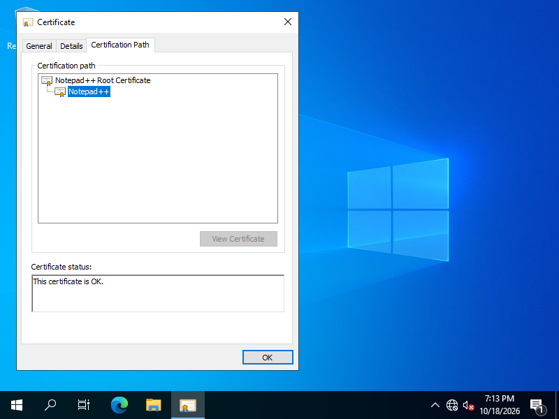
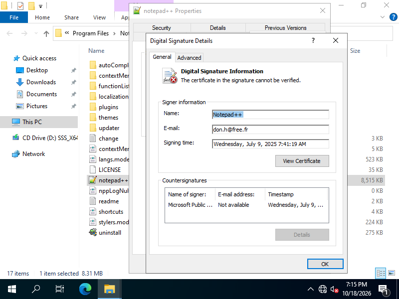

# Notepad++ 軟體簽章與憑證驗證實驗

題目來源：[Software Signature and Certificate Example - Notepad++](https://hackmd.io/WkND2kC1Sz-fJ9lHR87lEQ)。

進度：2026-10-18 完成 GPG、SHA-256、內嵌簽章，以及 Windows 虛擬機內的憑證匯入、驗證與移除，已於同日寄送。講義目前沒有標上作業編號。

## 題目與要求

依講義使用 **Notepad++ 8.8.3**，驗證下載檔案的完整性，檢視程式碼簽章，並比較是否信任 Notepad++ 自簽根憑證時的結果。

實驗分成兩部分：先驗證下載的安裝檔，再於離線 Windows 虛擬機安裝 Notepad++ 8.8.3，操作憑證匯入精靈與 `certmgr.msc`，比較信任根憑證前後的結果。主機只做檔案準備及唯讀檢查，沒有匯入這張根憑證。先前的 Signify 隔離驗證另行保留，與本次 Windows 實際操作分開記錄。

[返回作業總覽](../../README.md)

## 操作步驟

### 1. 下載指定版本與驗證資料

從[官方 v8.8.3 發行頁](https://github.com/notepad-plus-plus/notepad-plus-plus/releases/tag/v8.8.3)下載以下四個檔案，放在 `input/`：

- `npp.8.8.3.Installer.x64.exe`
- `npp.8.8.3.Installer.x64.exe.sig`
- `npp.8.8.3.checksums.sha256`
- `npp.8.8.3.checksums.sha256.sig`

另下載官方的 [GPG 公開金鑰](https://notepad-plus-plus.org/gpg/nppGpgPub.asc)與[自簽根憑證](https://npp-user-manual.org/docs/certs/nppRoot.crt)，保留檔名 `nppGpgPub.asc`、`nppRoot.crt`。

### 2. 驗證 GPG 簽章與 SHA-256

在 Git Bash 中執行：

```bash
gpg_home="$(mktemp -d)"
gpg --homedir "$gpg_home" --import input/nppGpgPub.asc
gpg --homedir "$gpg_home" --no-auto-key-retrieve \
  --verify input/npp.8.8.3.Installer.x64.exe.sig input/npp.8.8.3.Installer.x64.exe
gpg --homedir "$gpg_home" --no-auto-key-retrieve \
  --verify input/npp.8.8.3.checksums.sha256.sig input/npp.8.8.3.checksums.sha256
sha256sum input/npp.8.8.3.Installer.x64.exe
grep 'Installer.x64.exe' input/npp.8.8.3.checksums.sha256
```

本次兩份 GPG 驗證均成功。簽署金鑰的完整指紋為：

```text
14BC E436 2749 B2B5 1F8C 7122 6C42 9F1D 8D84 F46E
```

### 3. 檢查安裝檔的 Windows 簽章

在 PowerShell 中執行：

```powershell
Get-AuthenticodeSignature input/npp.8.8.3.Installer.x64.exe |
    Format-List Status, StatusMessage, SignerCertificate
```

本次 Windows 回報 `UnknownError`，詳細訊息是「憑證鏈結無法建立於受信任的根授權」。簽署者憑證指紋為 `7F517E235584AFC146F6D3B44CD34C6CC36A3AB2`，與講義列出的值相同。這個結果不能單獨解讀為檔案已遭修改。

### 4. 補充：在隔離信任清單中比較

使用 Python 3、Signify 0.9.3 與 cryptography 50.0.2。可在獨立 Python 環境安裝[指定套件](requirements.txt)，再執行[驗證程式](verify-authenticode.py)：

```bash
python -m pip install -r requirements.txt
python verify-authenticode.py --input input --output output
```

程式先核對根憑證指紋，再驗證三種情況：預設信任清單、額外信任本題根憑證，以及只改動安裝檔第一個 PE section 中一個位元組的負例。變造內容只存在記憶體中，原始下載檔案不會被修改。

Signify 會核對檔案的 Authenticode 摘要、簽章及憑證鏈；相關行為可查閱其[官方文件](https://signify.readthedocs.io/en/latest/authenticode.html)。這次關閉 CRL／OCSP 網路擷取，沒有提供即時撤銷資料，因此結果不包含完整的線上撤銷狀態查驗。

### 5. 在 Windows 虛擬機完成講義操作

使用 VirtualBox 7.2.20 與 Microsoft 官方 Windows Server 2022 Standard Evaluation（含桌面）。教授提供的 RH76 映像是 Linux，這份實驗需要 Windows 憑證管理介面，因此另外建立 Windows 實驗機。VM 配置為 4 核心、6 GB 記憶體，關閉所有網卡、共用剪貼簿、拖放及共用資料夾。實驗帳號為 `lab`。

1. 在 VM 安裝 Notepad++ 8.8.3，檢查 `C:\Program Files\Notepad++\notepad++.exe`。匯入前，根憑證及簽署者憑證都顯示信任問題。
2. 開啟 `nppRoot.crt`，按下「Install Certificate」，選擇 **Current User**，再指定 **Trusted Root Certification Authorities**。核對警告上的完整指紋後，僅在 VM 內確認匯入。
3. 重新檢查簽署者的 Certification Path，顯示 **This certificate is OK**；PowerShell 的 `Get-AuthenticodeSignature` 也回報 `Valid`。
4. 開啟 `certmgr.msc`，在「Certificates - Current User → Trusted Root Certification Authorities → Certificates」找到 Notepad++ Root Certificate。
5. 選取這張根憑證並刪除，再次核對刪除確認視窗中的指紋。移除後，簽署者與檔案簽章明細再次顯示無法驗證信任，PowerShell 回報 `UnknownError`，原因是無法建立至受信任根憑證的鏈結。

三個階段都檢查同一個 `notepad++.exe`。它的 SHA-256 始終是：

```text
3c729c08da054834a6f7c6287539670d5a4b64a37017b03536d5e2ea57390fe7
```

這個值與前面的「安裝檔」雜湊不同，因為兩者是不同檔案。VM 的 Local Machine 根存放區在三個階段都沒有這張憑證，主機的 Current User／Local Machine 也都沒有。

以下均為實驗 VM 的原始畫面截圖：

| 階段 | 截圖 |
| --- | --- |
| 匯入前 | [根憑證不受信任](screenshots/01-root-before-import.png)、[簽署者無法驗證](screenshots/02-signer-before-import.png) |
| 匯入設定 | [目前使用者](screenshots/03-import-current-user.png)、[指定根存放區](screenshots/04-import-root-store.png) |
| 匯入確認 | [核對指紋的警告](screenshots/05-root-import-warning.png)、[匯入成功](screenshots/06-import-success.png) |
| 匯入後 | [簽署者憑證](screenshots/07-signer-after-import.png)、[憑證路徑正常](screenshots/08-chain-valid.png)、[憑證管理器中的根憑證](screenshots/09-root-in-certmgr.png) |
| 移除 | [刪除確認](screenshots/10-remove-confirmation.png)、[再次核對指紋](screenshots/11-remove-fingerprint.png)、[清單中已移除](screenshots/12-root-removed.png) |
| 移除後 | [簽署者再次無法驗證](screenshots/13-signer-after-removal.png)、[程式的數位簽章頁](screenshots/14-file-digital-signatures.png)、[簽章明細無法驗證](screenshots/15-signature-details-after-removal.png) |





## 執行結果

| 檢查項目 | 結果 |
| --- | --- |
| 安裝檔 GPG 簽章 | `GOODSIG`、`VALIDSIG`，回傳碼 0 |
| 官方 SHA-256 清單的 GPG 簽章 | `GOODSIG`、`VALIDSIG`，回傳碼 0 |
| 安裝檔 SHA-256 | 與已驗證的官方清單完全相符 |
| Windows 預設信任狀態 | 無法建立至受信任根憑證的鏈結 |
| Signify 預設信任清單 | `CERTIFICATE_ERROR` |
| Signify 隔離清單加入本題根憑證 | `OK` |
| 改動 PE section 的一個位元組後 | `INVALID_DIGEST` |
| Windows VM 匯入前 | 根憑證不存在；程式簽章為 `UnknownError`，無法建立信任鏈 |
| Windows VM 匯入後 | Current User 根憑證存在；程式簽章為 `Valid` |
| Windows VM 移除後 | 根憑證不存在；程式簽章恢復為相同的信任鏈錯誤 |

安裝檔 SHA-256：

```text
7094a07167648628e47249a16d9d6db922e5aa1255ac4322a2e4900d233372dd
```

根憑證的 SHA-1 指紋為 `C80539FF7076D22E73A01F164108DAFBF06E45E4`，有效期間是 2025-07-09 至 2055-07-09（臺灣時間），與講義相同。SHA-1 在這裡用來對照憑證指紋，不是本次安裝檔的完整性雜湊。

- [GPG 驗證紀錄](output/gpg-verification.txt)
- [Windows 原始簽章檢查](output/windows-authenticode.json)
- [隔離信任與檔案變造測試](output/authenticode.json)
- [六份下載檔案的大小及 SHA-256](output/download-hashes.json)
- VM 原始檢查：[匯入前](output/vm-before-install.json)、[匯入後](output/vm-after-install.json)、[移除後](output/vm-after-removal.json)
- [VM 環境與隔離設定](output/vm-environment.json)、[主機最終唯讀檢查](output/host-trust-after.json)、[截圖雜湊清單](output/screenshot-hashes.json)

前三份既有驗證紀錄保留當時的原始內容，其中「未執行安裝程式」描述的是先前安裝檔靜態檢查；本次新增的 `vm-*.json` 才是 Windows VM 安裝程式後的實測。VM 沒有網路，本次結果不能代表即時 CRL／OCSP 撤銷檢查也已通過。

## 學習觀察

檔案內容是否符合簽章，以及簽署者是否受到信任，需要分開看。這次同一個程式檔案沒有改變，但 VM 匯入根憑證後驗證通過，移除後又恢復信任鏈錯誤。這說明驗證結果也取決於使用者的信任設定。另一個隔離測試則顯示，若改動程式內容，即使信任該根憑證，摘要仍會驗證失敗。

講義最後另有註記：從 v8.8.7 起改用 GlobalSign 簽發的憑證，不再需要安裝舊自簽根憑證，並建議移除先前安裝的根憑證。因此本次將 8.8.3 當作歷史實驗樣本，不把安裝舊根憑證當成日常使用建議。
