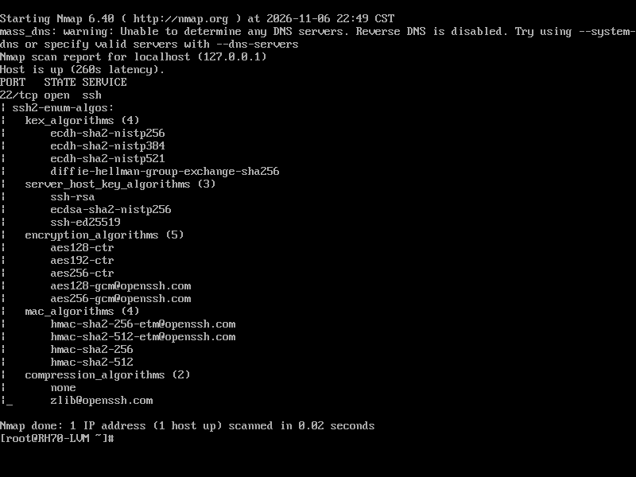

# SSH 演算法檢查與設定修正

題目來源：[SSH Vulnerability](https://hackmd.io/unmKSqywRNCtXVS2L8nN0A)，課程日期 11/02。

進度：2026-11-06 完成 VM 實測、設定修正與截圖，已於 2026-11-06 寄送。講義標為 Lab，未指定 HW4 或 HW5。

[返回作業總覽](../../README.md)

## 題目與環境

依講義查詢 SSH 支援的演算法，使用 Nmap 檢查伺服器實際提供的項目，再修正 Cipher、MAC 與 KEX 設定。題目特別要求找出範例設定的問題，不能只把清單貼進設定檔。

使用老師提供的 RH70-LVM 映像，在 VirtualBox 中實際啟動。VM 關閉全部八張網卡，僅掃描自己的 `127.0.0.1`，沒有對外連線。映像沒有可用的 Guest Additions，因此以唯讀 ISO 傳入腳本，透過 VM 的虛擬序列埠輸出紀錄；主機未執行 SSH 設定修改。

實測版本為 **OpenSSH 6.6.1p1**、OpenSSL 1.0.1e、Nmap 6.40，並非講義輸出範例中的 OpenSSH 6.4。完整版本見[環境紀錄](output/environment.txt)。

## 操作步驟

1. 在 VM 查詢 `ssh -Q cipher`、`ssh -Q mac`、`ssh -Q kex`、`ssh -Q key`，保留本機程式支援的完整清單。
2. 執行 `sshd -T`、`nmap -sV 127.0.0.1` 與 `nmap -Pn -p22 --script ssh2-enum-algos 127.0.0.1`，記錄修改前的有效設定與伺服器提供的演算法。
3. 保留原始 `sshd_config`。先以 `sshd -t -f 原設定 -o KexAlgorithms=演算法名稱`，個別測試講義中的兩個 Curve25519 名稱；這項測試不會改動正在運行的服務。
4. 產生候選設定，先通過 `sshd -t` 才套用並重啟 `sshd`。本次三項設定如下：

```text
Ciphers aes128-ctr,aes192-ctr,aes256-ctr,aes128-gcm@openssh.com,aes256-gcm@openssh.com
MACs hmac-sha2-256-etm@openssh.com,hmac-sha2-512-etm@openssh.com,hmac-sha2-256,hmac-sha2-512
KexAlgorithms ecdh-sha2-nistp256,ecdh-sha2-nistp384,ecdh-sha2-nistp521,diffie-hellman-group-exchange-sha256
```

5. 再次檢查有效設定與 Nmap 輸出，確認伺服器實際提供的項目已改變，並確認 `sshd` 為 `active`。
6. 用 SSH 用戶端進行一次指定 AES-CTR／SHA-2 MAC 的傳輸層交握，再分別強制使用 CBC、MD5 MAC、group1 KEX，確認被伺服器拒絕。所有連線皆限於 VM 自身。

[實驗腳本](scripts/ssh-lab.sh)與[套用的三項設定](output/applied-policy.txt)一併保留；原始設定留在 VM 私人工作目錄。實驗結束後停止 SSH 服務並關閉 VM。

## 找到的問題

**演算法名稱必須符合實際版本。** 這台 VM 對 `curve25519-sha256` 回報 `Unsupported KEX algorithm`，設定檢查回傳 `255`；對 `curve25519-sha256@libssh.org` 則接受，回傳 `0`。因此不能把講義的整行 KEX 原樣套入，也不能說這個版本完全不支援 Curve25519。實測見[不支援的名稱](output/check-curve25519-sha256.txt)、[完整回傳碼](output/exit-codes.txt)及[支援清單](output/supported-kex.txt)。OpenSSH 的[6.5 版本說明](https://www.openssh.org/txt/release-6.5)也記錄了 Curve25519 與 Ed25519 的加入。

**移除 CBC 後仍須檢查其餘項目。** 講義的 Ciphers 範例保留 `arcfour256`、`arcfour128`。本次改成這台 VM 支援的 AES-CTR／AES-GCM 清單；OpenSSH 後續的[7.6 版本說明](https://www.openssh.org/txt/release-7.6)已列出移除 arcfour 支援。

**「設定被接受」與「設定選得合適」是兩件事。** 講義的 MAC 範例雖移除了 MD5／96 位元項目，卻沒有選用這台 VM 已支援的 SHA-2 MAC。本次明確選用 SHA-2 及其 EtM 形式，並用掃描確認生效；沒有把可通過語法檢查當成完整安全評估。

## 執行結果

| 項目 | 修改前 | 修改後 |
| --- | --- | --- |
| KEX | 8 項，包含 group1／SHA-1 項目 | 4 項：三種 ECDH、group-exchange-sha256 |
| 加密演算法 | 16 項，包含 CBC、3DES、arcfour | 5 項：三種 AES-CTR、兩種 AES-GCM |
| MAC | 19 項，包含 MD5、96 位元項目 | 4 項 SHA-2 MAC |
| Host key 演算法 | 3 項 | 3 項，本次未調整 |
| SSH 服務 | 可被掃描 | 設定檢查通過，重啟後為 `active` |

| 連線測試 | 實際結果 |
| --- | --- |
| 指定 AES128-CTR、HMAC-SHA2-256 | 完成 `SSH2_MSG_NEWKEYS`，證明傳輸層交握成功；後續身分驗證被拒絕 |
| 強制 AES128-CBC | `no matching cipher found` |
| 強制 HMAC-MD5，配合 AES128-CTR | `no matching mac found` |
| 強制 diffie-hellman-group1-sha1 | `Unable to negotiate a key exchange method` |

上述連線均回傳 `255`，但原因不同。第一項是在交握完成後因未提供獲授權的登入憑證而失敗；其餘三項在演算法協商階段就被拒絕。本次沒有把傳輸層交握成功寫成登入成功。

- [修改前掃描](output/before-algorithms.txt)、[修改後掃描](output/after-algorithms.txt)
- [修改前有效設定](output/before-effective.txt)、[修改後有效設定](output/after-effective.txt)
- [正常傳輸層交握](output/strong-handshake.txt)、[拒絕 CBC](output/reject-cbc.txt)、[拒絕 MD5](output/reject-md5.txt)、[拒絕 group1](output/reject-group1.txt)
- [語法檢查回傳碼](output/exit-codes.txt)、[服務狀態](output/service-state.txt)、[服務紀錄](output/service-log.txt)、[設定雜湊](output/guest-hashes.txt)

## 實際截圖

以下是 VM 主控台顯示已保存實測紀錄的原始畫面，拍攝於 2026-11-06。

- [實際版本與 KEX 名稱測試](screenshots/01-version-and-kex-check.png)
- [修改後伺服器提供的演算法](screenshots/02-advertised-algorithms-after.png)
- [傳輸層交握與三項拒絕測試](screenshots/03-transport-and-negative-cases.png)



## 學習觀察

`ssh -Q` 查的是程式支援能力，`sshd -T` 查的是有效設定，Nmap 則觀察伺服器對外提供的項目；三者不能互相取代。這次真正的範例錯誤，是使用了該版本不接受的 KEX 名稱。修正時必須先測語法，再重新掃描，最後用連線確認排除的演算法真的無法協商。

這份結果限於舊版軟體的隔離實驗，沒有完成整台主機的弱點評估，也未把版本字串當成特定 CVE 可被利用的證明。Host key、登入政策與其他服務不在本次三項演算法設定的調整範圍內。
