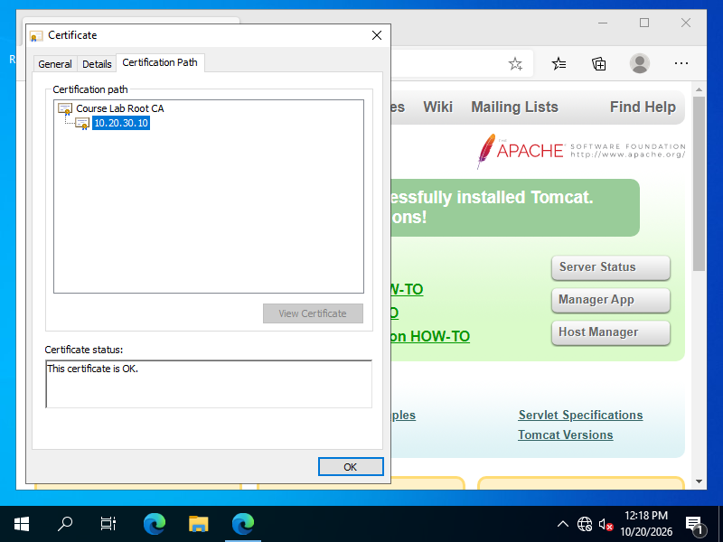

# Tomcat 自建 CA 與 HTTPS 憑證實驗

題目來源：[Trusted Self-Signed SSL Certificate Configuration for Apache-Tomcat (7.x)](https://hackmd.io/V7VikaDmT928w_vMxDHaWQ)，課程日期 10/19。

進度：2026-10-20 完成 VM 實測與截圖，2026-11-06 整理報告；尚未寄送。講義標為 Lab，未指定 HW4 或 HW5。

[返回作業總覽](../../README.md)

## 題目與環境

建立自己的根 CA，用它簽發 Tomcat 伺服器憑證，再比較用戶端信任這張根憑證前後的結果。

伺服器採老師提供的 Tomcat-RH7 映像：CentOS 7.9、Tomcat 7.0.76、OpenJDK 8u352、OpenSSL 1.0.2k；用戶端是 Windows Server 2022 Evaluation VM。兩台 VM 只接 VirtualBox Internal Network，沒有預設閘道、主機網路介面或外網連線。所有憑證匯入都在 Windows VM 的目前使用者存放區進行。

| 項目 | 本次設定 |
| --- | --- |
| 伺服器 | `10.20.30.10/24` |
| 用戶端 | `10.20.30.20/24` |
| 伺服器名稱 | `Tomcat-SSL`，由用戶端 VM 的 hosts 檔對應 |
| 根 CA | `Course Lab Root CA`，RSA 4096 位元，有效期 3650 天 |
| 伺服器憑證 | RSA 2048 位元，有效期 365 天 |
| SAN | `DNS:Tomcat-SSL`、`DNS:tomcat-ssl`、`IP:10.20.30.10` |
| HTTPS | `8443`，本次限定 TLS 1.2 |

映像原本已帶有舊 keystore 和 8443 設定。本次先將原設定及 keystore 保留在 VM 的私人目錄，再移除原本的 HTTPS Connector，確認只剩 HTTP 8080，才重新產生金鑰與憑證。下列結果使用的是本次新建的 CA，沒有把映像內建的成果當成自己完成的步驟。

## 操作步驟

以下對照講義的 11 個步驟；完整實作見 [VM 伺服器腳本](scripts/server-lab.sh)。腳本須在實驗 VM 內執行，金鑰、keystore 和密碼不納入公開報告。

| 講義步驟 | 實際操作與查驗 |
| --- | --- |
| 1. 伺服器私鑰 | 用 `openssl genrsa` 產生 RSA 2048 位元金鑰 |
| 2. CSR | 用 `openssl req -new` 產生 CSR，CN 設為本次伺服器 IP；[CSR 內容](output/tomcat_csr.txt) |
| 3. SAN | 加入主機名稱及 IP，另明列 `CA:FALSE`、`serverAuth` 與金鑰用途；[簽發後內容](output/tomcat_text.txt) |
| 4. CA 私鑰 | 另產生 RSA 4096 位元 CA 金鑰，不與伺服器共用 |
| 5. CA 憑證 | 產生自簽根憑證，明列 `CA:TRUE`、`keyCertSign`、`cRLSign`；[根憑證內容](output/rootCA_text.txt) |
| 6. 簽發伺服器憑證 | 使用 CA 私鑰簽署 CSR，帶入 SAN 設定，產生 `tomcat.crt` |
| 7. JKS 匯入根憑證 | 別名 `rootca`，確認為 `trustedCertEntry`；[匯入伺服器項目前的清單](output/keytool_root_only.txt) |
| 8. PKCS#12 | 封裝伺服器私鑰、憑證與根憑證；[不含私鑰內容的清單](output/keytool_p12_list.txt) |
| 9. 匯入伺服器項目 | 別名 `tomcat`，確認為 `PrivateKeyEntry`，憑證鏈長度為 2；[最終 JKS 清單](output/keytool_jks_list.txt) |
| 10. 設定 Tomcat | 加入 8443 NIO Connector，keystore 設為 `root:tomcat`、權限 `0640`，重啟服務；[已遮蔽密碼的實際設定](output/tomcat-connector.json) |
| 11. 用戶端信任 | 在 Windows VM 匯入根憑證，重啟瀏覽器檢查 IP、主機名稱及憑證鏈；完成後移除根憑證再測一次 |

本次使用獨立的實驗名稱及 IP，沒有沿用講義範例中的教授身分。相較講義，伺服器憑證有效期改為 365 天，並明確限制 TLS 1.2；加密套件仍採講義的八種 AES 套件。這些是本次實驗設定，不代表正式服務的部署建議。

## 驗證結果

| 檢查 | 實際結果 |
| --- | --- |
| HTTP 8080 | HTTP 200，瀏覽器顯示未加密 |
| curl 未指定 CA | 回傳碼 `60`，根 CA 不受信任 |
| curl 指定 CA，使用 IP | 回傳碼 `0`、HTTP 200 |
| curl 指定 CA，使用 `Tomcat-SSL` | 回傳碼 `0`、HTTP 200 |
| curl 指定 CA，使用錯誤名稱 | 回傳碼 `51`，名稱不符 |
| OpenSSL 指定 CA | 回傳碼 `0`，`Verify return code: 0 (ok)` |
| Nmap 憑證檢查 | 8443 開啟，憑證主體為 `10.20.30.10` |
| Nmap 加密套件檢查 | 列出 TLS 1.2 與八種 AES 套件，未列出 RC4、3DES 或 TLS 1.0／1.1 |

嚴格驗證使用下列命令，沒有加上 `-k`：

```bash
curl -I --cacert rootCA.pem https://10.20.30.10:8443/
curl -I --cacert rootCA.pem --resolve Tomcat-SSL:8443:10.20.30.10 https://Tomcat-SSL:8443/
curl -I --cacert rootCA.pem --resolve wrong-host.lab:8443:10.20.30.10 https://wrong-host.lab:8443/
openssl s_client -connect 10.20.30.10:8443 -CAfile rootCA.pem -verify_return_error </dev/null
nmap -p 8443 --script ssl-cert 10.20.30.10
nmap -p 8443 --script ssl-enum-ciphers 10.20.30.10
```

講義的 `curl -vkI` 另有保留，但 `-k` 會略過憑證驗證，不能拿它成功連線當成「已信任憑證」的證據。

Windows VM 的三階段結果如下，IP 與主機名稱皆得到相同變化：

| 階段 | Current User 根憑證 | 嚴格 HTTPS 檢查 | 瀏覽器 |
| --- | --- | --- | --- |
| [匯入前](output/client-before.json) | 不存在 | 信任鏈錯誤 | `NET::ERR_CERT_AUTHORITY_INVALID` |
| [匯入後](output/client-after.json) | 存在 | HTTP 200 | 顯示連線安全、憑證有效 |
| [移除後](output/client-removed.json) | 不存在 | 恢復信任鏈錯誤 | 恢復不受信任警告 |

三階段的 Local Machine 存放區都沒有這張根憑證。[主機唯讀檢查](output/host-trust-after.json)也確認主機未匯入本次根憑證。

## 實際截圖與紀錄

截圖均取自 VirtualBox 客體畫面，拍攝日期為 2026-10-20，未改動影像內容。

| 階段 | 截圖 |
| --- | --- |
| 初始狀態 | [HTTP](screenshots/01-http-before-tls.png)、[HTTPS 不受信任](screenshots/02-https-untrusted.png)、[根憑證未受信任](screenshots/03-root-untrusted.png) |
| 匯入 | [目前使用者](screenshots/04-import-current-user.png)、[根存放區](screenshots/05-import-root-store.png)、[核對指紋](screenshots/06-import-fingerprint.png)、[成功](screenshots/07-import-success.png) |
| 信任後 | [IP 連線](screenshots/08-https-trusted-ip.png)、[連線安全](screenshots/09-browser-connection-secure.png)、[伺服器憑證](screenshots/10-server-certificate.png)、[憑證鏈正常](screenshots/11-valid-certificate-chain.png)、[主機名稱連線](screenshots/12-https-trusted-dns.png) |
| 移除 | [憑證管理器](screenshots/13-root-in-certmgr.png)、[刪除前核對指紋](screenshots/14-remove-fingerprint.png)、[已移除](screenshots/15-root-removed.png)、[恢復警告](screenshots/16-https-untrusted-after-removal.png) |



- [curl 回傳碼](output/curl_exit_codes.txt)、[錯誤主機名稱](output/curl_wronghost_fail.txt)
- [OpenSSL 憑證鏈驗證](output/openssl_sclient_handshake.txt)、[Nmap 憑證](output/nmap_ssl_cert.txt)、[Nmap 加密套件](output/nmap_ssl_ciphers.txt)
- [環境版本](output/versions.txt)、[VM 設定](output/vm-environment.json)、[截圖雜湊](output/screenshot-hashes.json)
- [Windows VM 檢查腳本](scripts/client-check.ps1)

根憑證 SHA-256 指紋：`24369e2dd601fe15530bdd230efc5509c457dbf63b09efc07c20ff741be65f8f`。公開的 PEM 僅含公鑰憑證；私鑰、JKS、PKCS#12 與密碼均留在 VM 私人目錄。OpenSSL 日誌中的 TLS 工作階段祕密已遮蔽，原始日誌另存本機私人工作目錄。

## 學習觀察

伺服器送出憑證不代表用戶端就會信任它。這次同一張伺服器憑證，在用戶端加入根 CA 後通過驗證，移除後又失敗；即使指定正確 CA，使用不在 SAN 裡的名稱仍會被拒絕。

這是舊版軟體的隔離教學實驗。Nmap 6.40 的 `strong` 標示只記錄當時工具的判定，不能推論這套設定符合今日所有安全要求；本次也沒有進行線上撤銷狀態查詢。實驗結束後已移除 Windows VM 的根憑證並停止服務、關閉 VM。
